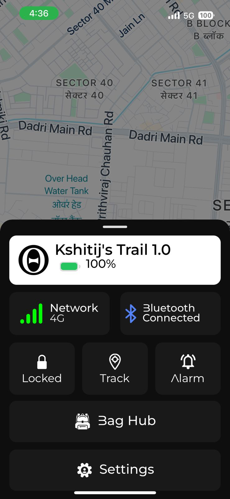
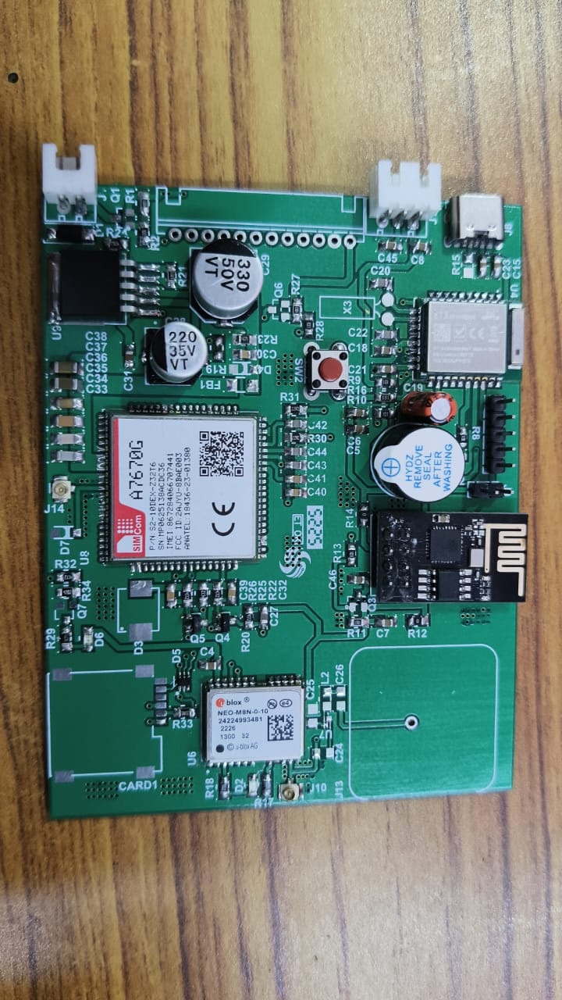
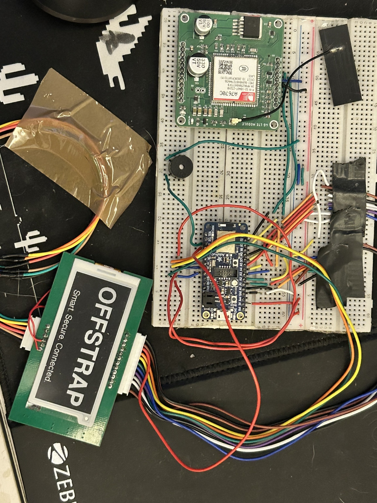

# OffStrap - Smart Luggage

OffStrap is a smart backpack I designed, built, manufactured, and sold as a startup. It combines GPS and cellular tracking, fingerprint security, an E-Paper display, and a 10,000mAh battery bank. The project is discontinued, after a regulatory change around power bank transport and shipping made the built in battery, which was core to the product, impractical to legally ship and sell.

Storefront (archived, waitlist only): [shop.offstrap.com](https://shop.offstrap.com/)

## What it does

- GPS and GSM/LTE tracking through a SIMCom A7670G-LABC module, so the bag can be located independent of the owner's phone
- Fingerprint based locking (ZW0642 sensor)
- An E-Paper display for status, lost mode info, and OTP pairing, which persists even when the internal battery is dead
- A 10,000mAh power bank built in, doubling as a phone charger
- BLE for nearby interaction, cellular for out of range communication
- A companion app for provisioning, live status, tracking, lost mode, and account management

```
                     OFFSTRAP
                        |
         ---------------------------------------------------------
         |                             |                          |
     SECURITY                    CONNECTIVITY                INTERFACE
         |                             |                          |
  Fingerprint auth              BLE / LTE / GNSS            E-Paper display
  Lock state                    App link                    Alarm / status
  Tamper detection
```

## Repo structure

- **[`app/`](app/)** - the React Native companion app: screens, BLE logic, cloud sync, and screenshots. See [`app/README.md`](app/README.md).
- **[`hardware/`](hardware/)** - firmware/PCB documentation, prototype and PCB photos, and a device simulator. Arduino source will land in `hardware/firmware/`. See [`hardware/README.md`](hardware/README.md).

## A glimpse

<table>
<tr>
<td></td>
<td></td>
<td></td>
</tr>
<tr>
<td align="center">App dashboard</td>
<td align="center">Custom PCB</td>
<td align="center">Early prototype</td>
</tr>
</table>

## Development approach

Development moved through dev boards proving each subsystem separately (microcontroller, BLE, fingerprint sensor, display, alarm), then a functional prototype integrating those subsystems, then the React Native app, then a custom PCB replacing the dev board stack entirely (nRF52840 class MCU, A7670G-LABC LTE module, u-blox NEO-M8N GNSS).

Design principles followed throughout:

- Security state is driven by physical events, not software triggers. A BLE command cannot independently trigger a fingerprint verification, only a physical finger event can.
- Power hungry peripherals sleep by default. The fingerprint sensor, display, modem, and GNSS module are not continuously active.
- The exact purchased component is the source of truth for hardware design. Modem variants are not interchangeable, so the A7670G-LABC implementation was built from its own documentation rather than a similar sounding module's.
- Hardware and firmware are designed together, not handed off separately.

## Traction

- Paid advertising run on Meta to validate demand
- A waitlist of approximately 500 people at a 9,999 rupee price point
- A bulk order inquiry for 350 to 400 units from a company, following a product demo

## Note on this repo

This is a cleaned copy of the working codebase. Build artifacts, CocoaPods dependencies, and Ruby vendor bundles are excluded since they are regenerable and not source code. API keys, credentials, and personal contact details present in the original files have been removed. App and firmware logic is unchanged.
