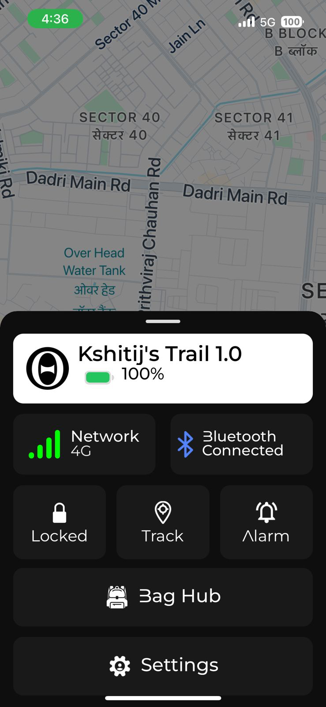
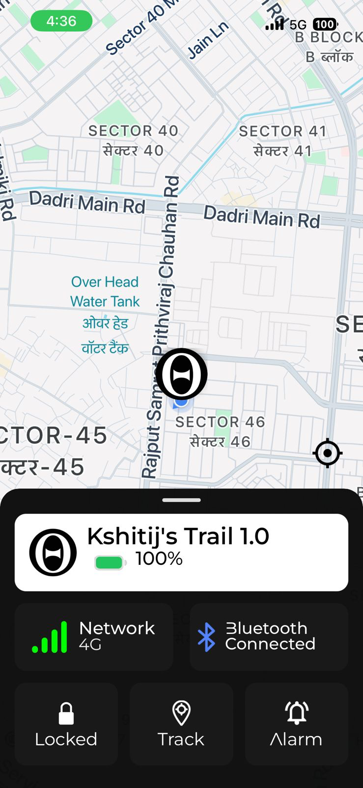
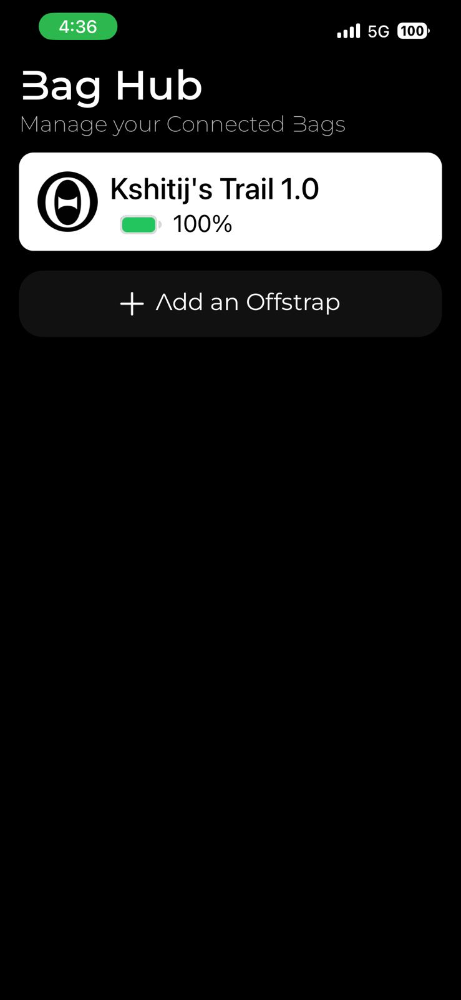
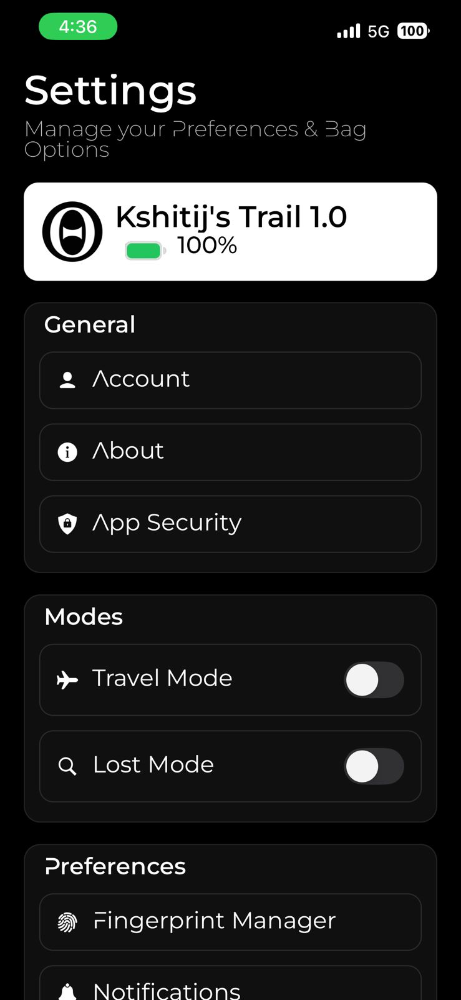
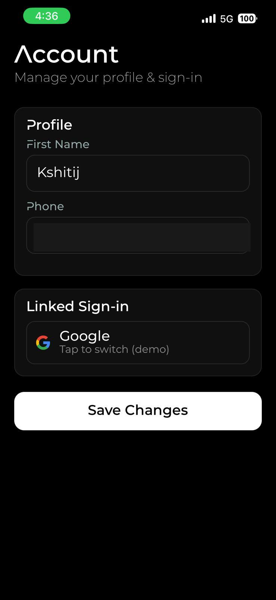
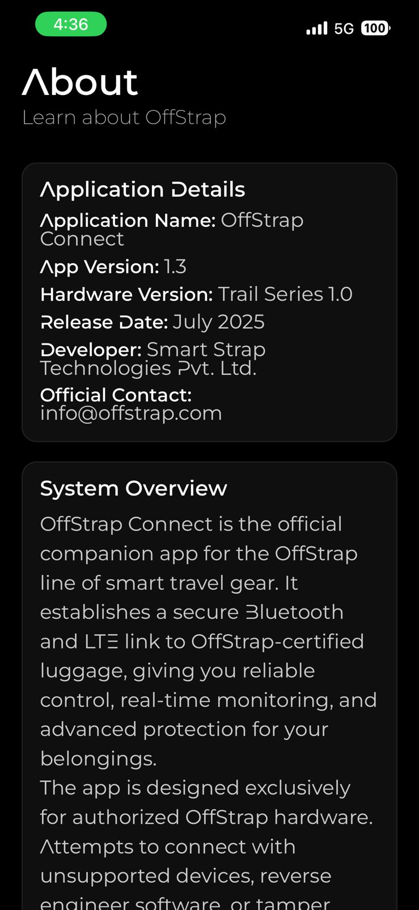
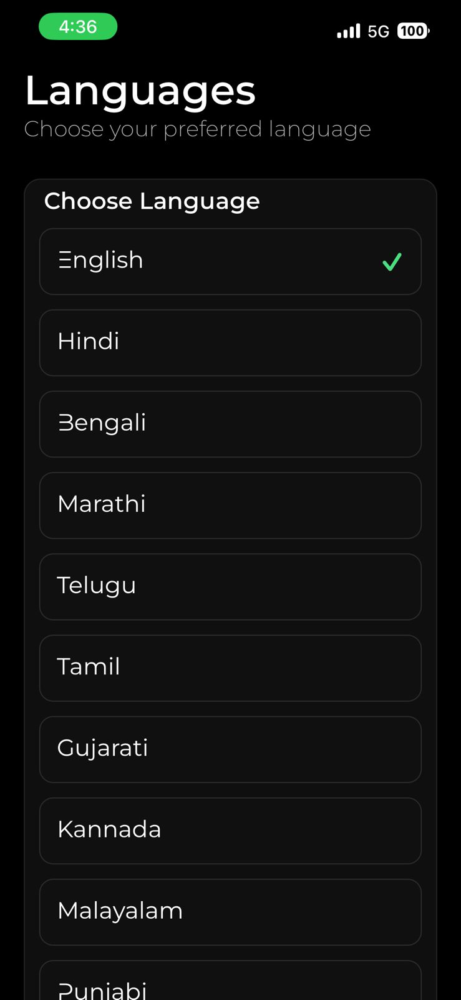

# OffStrap Connect - Companion App

This is the React Native app I built for OffStrap. It handles device provisioning, real time BLE and cellular status, fingerprint gated app security, live GPS tracking, and managing multiple bags.

## Screens

<table>
<tr>
<td></td>
<td></td>
<td></td>
<td></td>
</tr>
<tr>
<td align="center">Dashboard</td>
<td align="center">Live GPS tracking</td>
<td align="center">Multi-bag hub</td>
<td align="center">Settings</td>
</tr>
<tr>
<td></td>
<td></td>
<td></td>
<td></td>
</tr>
<tr>
<td align="center">Account</td>
<td align="center">About</td>
<td align="center">Languages</td>
<td></td>
</tr>
</table>

## What I built it with

- React Native 0.80 with TypeScript
- `react-native-ble-plx` for Bluetooth Low Energy communication with the device
- Firebase (Auth and Firestore) for the backend and cloud sync
- Google Sign-In and Apple Sign-In for onboarding
- `react-native-biometrics` to gate the app itself behind a fingerprint
- `react-native-maps` for live location
- i18next for multi language support (I added 10 Indian languages plus English)
- Push notifications, both local and remote

## Folder structure

```
app/
|-- App.tsx              # entry point
|-- screens/             # dashboard, bag hub, login, fingerprint setup, settings, etc.
|-- logics/
|   |-- ble/               # BLE connection and device communication
|   |-- bag/                 # bag state and context
|   |-- core/                 # auth utils, core reducer
|   |-- security/              # app level lock (fingerprint gate)
|   `-- notifications/          # push and local notification engine
|-- android/ , ios/       # native project files
|-- assets/               # images and icons
`-- screenshots/          # the screenshots above
```

## Running it

```bash
cd app
npm install

# iOS (needs CocoaPods)
bundle install
bundle exec pod install
npm run ios

# Android
npm run android
```

You'll need your own Firebase project and Google Maps API key. Check `ios/GoogleService-Info.plist` and `android/app/src/main/AndroidManifest.xml` for where those go. I stripped the real credentials out before publishing this.

## One note

`ios/Pods`, `ios/build`, and other native build artifacts are excluded through `.gitignore`. They're regenerable, not source code, so there's no reason to keep them in version control.
