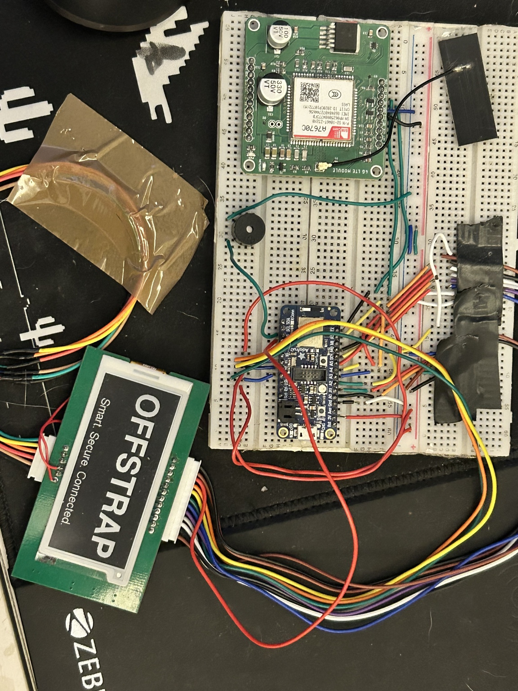
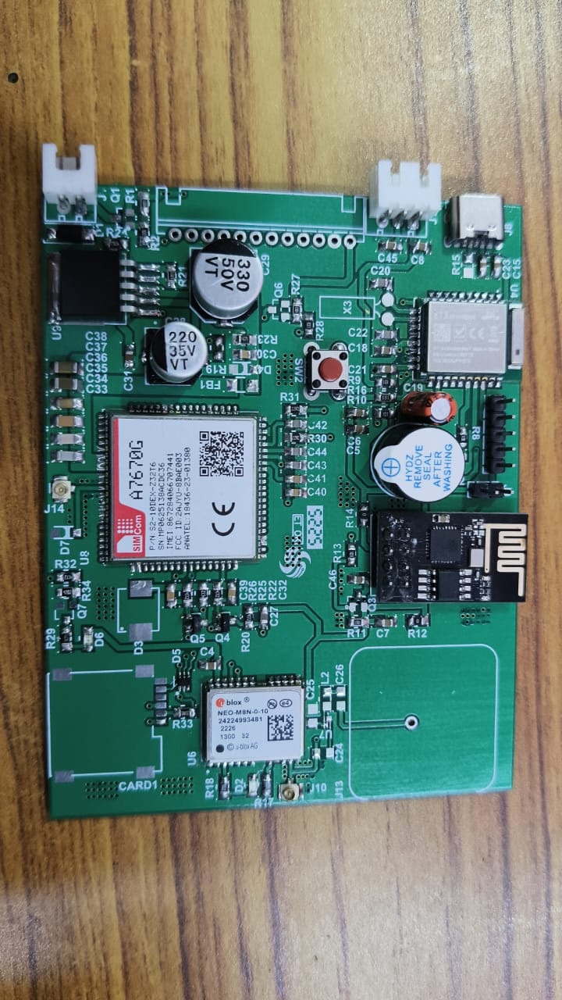
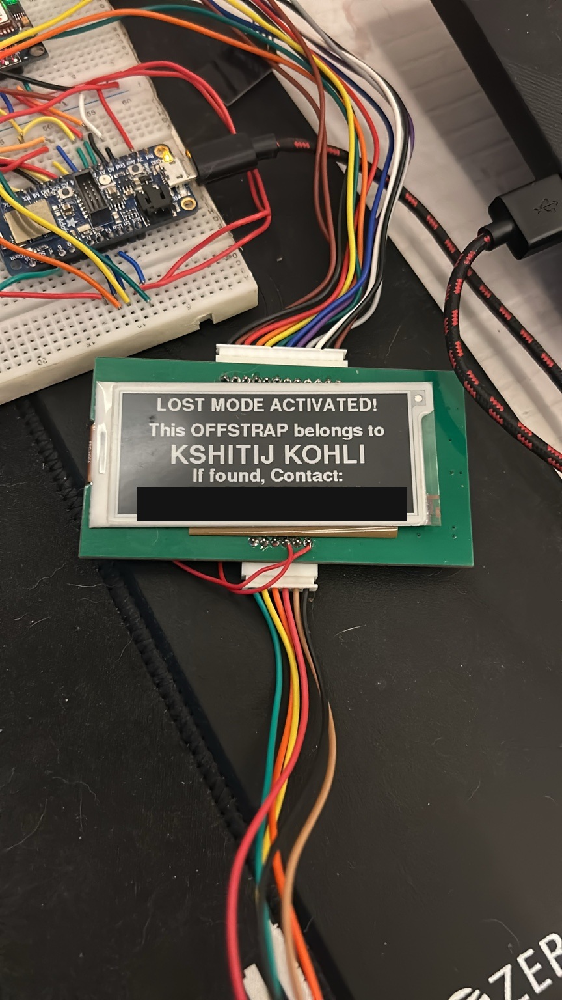
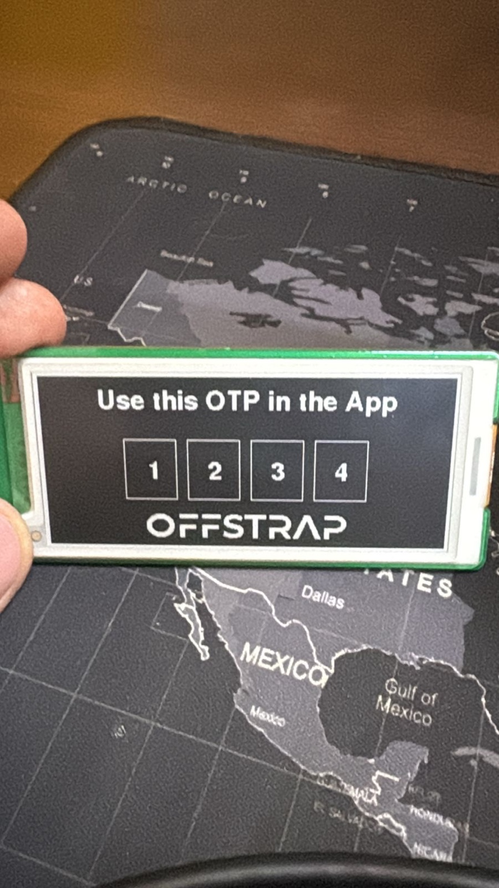

# OffStrap - Hardware and Firmware

This is the hardware and firmware side of OffStrap, a smart backpack security and tracking system I built around a Nordic nRF52840 as the main controller. It combines BLE connectivity, fingerprint authentication, an e-paper interface, an audible alarm, lost mode, and cellular connectivity.

I moved development from a breadboard prototype (built on off the shelf modules) to a custom populated PCB, with a SIMCom A7670G LTE Cat-1 module integrated directly onto the board alongside a u-blox GNSS module.

### From breadboard to custom silicon

| Early prototype | Custom PCB (populated) |
|---|---|
|  |  |

The breadboard build let me prove out BLE, fingerprint auth, the e-paper display, GSM/LTE connectivity, and the alarm system as separate pieces. The custom board brings the nRF52840 class MCU, the A7670 LTE module, and a u-blox NEO-M8N GNSS chip onto one board. This is the actual product hardware, not a stack of dev kits.

## Folder structure

```
hardware/
|-- README.md         (this file)
|-- photos/           prototype and PCB photos, device output (lost mode, OTP)
|-- firmware/          Arduino/.ino source (coming soon)
`-- ofs.py            a terminal based firmware/device simulator I wrote so I could
                       develop and test the app against realistic device behavior
                       without needing physical hardware on hand all the time
```

### It works, here's the real device output

**Lost mode**, activated remotely, shows owner contact info on the e-paper screen (I redacted the phone number before publishing this):



**OTP pairing flow.** The device generates a one time code on its own e-paper display for initial pairing with the app, so pairing can't just be intercepted over BLE alone:



---

## Project goals

I wanted OffStrap to have:

- Owner authentication
- Fingerprint based access and security
- BLE based owner interaction
- Lost mode functionality
- Audible tamper and alarm functionality
- Device identification
- An e-paper display
- Cellular connectivity
- GPS and location functionality
- Low power operation when security peripherals are idle
- A custom integrated PCB instead of a pile of dev boards and modules

I designed this as an actual embedded product, not just a prototype assembled from breakout boards.

## Main controller: Adafruit nRF52840 Feather

The main microcontroller is the Nordic nRF52840. I used an Adafruit nRF52840 Feather as the development platform while writing firmware.

Software environment: nRF52840, Adafruit Feather, Adafruit Bluefruit (v0.21.0), Adafruit BSP (1.7.0), TinyUSB

## Fingerprint authentication: ZW0642 module

| Function | nRF52840 |
|---|---|
| Fingerprint TX | D12 |
| Fingerprint RX | D11 |
| DET interrupt | D13 |
| UART baud rate | 57600 |

A key design requirement here: the fingerprint sensor stays asleep and only wakes on a stable finger touch (DET event). It runs exactly one verification, then goes back to sleep. BLE activity should never independently trigger a verification, only an actual physical finger event can.

```
Fingerprint asleep
       |
Stable finger detected
       |
Wake fingerprint module
       |
Perform exactly ONE verification
       |
Authentication successful?
       |-- YES -> reset tamper to 0 -> wait for finger removal -> sleep
       `-- NO  -> handle failed authentication -> sleep
```

## BLE

- I use an OTP gated BLE pairing process for initial owner setup
- After setup, the owner's device becomes bonded, owner functionality is available through that authenticated BLE relationship, and owner info is kept in nonvolatile storage
- The BagID is derived from the nRF52840's unique device UID and exposed through the BLE Device Information Service

## E-paper display

I use it for QR code display, OTP display, OffStrap branding, lost mode information, and custom text. I treat it as a low power peripheral, so it only refreshes when the displayed content actually changes.

## Alarm and tamper system

There's an active buzzer alarm tied to a tamper state. A successful fingerprint authentication resets the tamper state back to 0.

```
Normal -> tamper detected -> alarm/security response -> valid owner auth -> tamper reset
```

## Lost mode

Uses the e-paper display to show owner and contact information to whoever finds the backpack (see the photo above). It supports custom text, device ID, and QR/OTP related info.

## RSSI tracking

I use BLE RSSI as a relative proximity indicator, not a precise distance measurement, for owner proximity logic.

## Nonvolatile storage

InternalFS holds persistent device state, mainly owner/setup state and bond information.

## Cellular connectivity: SIMCom A7670G-LABC

The custom PCB integrates the SIMCom A7670G-LABC (LCSC: C21264513, SMD 24x24mm package), which is part of SIMCom's A7670X R2 family. This was a deliberate choice. The A7670 family has multiple variants (A7670C, A7670E, A7670G), and I built the PCB specifically around the A7670G-LABC's documented pinout, footprint, and reference circuits instead of approximating it from an A7670C design.

Key facts from the A7670X R2 hardware manual:
- 124 total module pins (80 outer LCC plus 44 inner LGA)
- 24 x 24 x 2.4 mm module dimensions
- 3.4V to 4.2V supply range, recommended around 3.8V

## GPS and GNSS

Whether the A7670G-LABC supports GNSS depends on the exact variant, so I added a separate u-blox NEO-M8N GNSS module on the board (visible in the PCB photo above) instead of assuming the cellular modem would provide location on its own.

```
                nRF52840
                    |
         ---------------------
         |                   |
    UART to LTE          UART/I2C
         |                   |
   A7670G-LABC          NEO-M8N GNSS
   (LTE)
```

## Overall hardware architecture

```
                     OFFSTRAP
                        |
         ------------------------------
         |                             |
   Main controller                Power system
         |                             |
   nRF52840 MCU                  Battery / charger
         |
 --------------------------------
 |        |         |           |
BLE  Fingerprint  E-paper      Alarm
 |     (ZW0642)      |           |
 |                User UI      Buzzer
 |
 -------------------
                    |
             Cellular UART
                    |
             A7670G-LABC (LTE Cat-1)
                    |
              SIM + LTE RF
                    |
             Cellular network

             NEO-M8N GNSS
```

## Firmware architecture

```
                  Main firmware
                        |
   -------------------------------------------------
   |             |       |          |               |
  BLE       Fingerprint E-paper    Alarm         Cellular
   |             |        |         |               |
Owner/Auth    ZW0642     UI      Security         A7670G
   |             |
   -------------------
            |
        InternalFS
```

## Power philosophy

I tried to make sure subsystems don't stay active when they don't need to be:

- Fingerprint: sleeps by default, wakes on touch, verifies once, sleeps again
- E-paper: only refreshes when the displayed content actually changes
- Cellular: has an intentional power/state management strategy rather than staying always on

## What's on the custom PCB

- nRF52840 class main controller
- SIMCom A7670G-LABC (LTE Cat-1)
- u-blox NEO-M8N (GNSS)
- Fingerprint UART interface plus DET line
- E-paper interface
- Buzzer/alarm driver
- Battery and power circuitry, plus charging circuitry
- SIM interface
- LTE antenna connection (50 ohm RF trace, following SIMCom's recommended layout)
- Debug and programming interfaces

Design workflow I followed: exact component selection, then datasheet verification, schematic, electrical review, footprint verification, layout, DRC, prototype, then bring up and testing.

## Design philosophy

1. Security events come from physical events, not accidental software activity
2. Power hungry peripherals sleep when they're not needed
3. Cellular power is managed deliberately, not left always on
4. The exact component I actually bought, not a similar sounding variant, is always the source of truth
5. RF design follows the modem manufacturer's recommended layout
6. I finish and review the schematic before routing the PCB
7. Every subsystem has a defined failure state

---

**In one line:** OffStrap is a low power smart backpack security system built around an nRF52840, combining BLE owner authentication, fingerprint security, e-paper interaction, tamper and alarm functionality, persistent device identity, and cellular tracking through a SIMCom A7670G-LABC modem plus a u-blox GNSS module, all on a custom integrated PCB.
